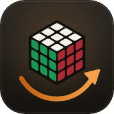

<p align="center"></p>

<h1 align="center">Cube Solver</h1>

<p align="center">
  Set up any 2x2 or 3x3 Rubik's cube, by scrambling, turning or painting stickers, and get<br />
  optimal or near-optimal solutions, ranked next moves, and step-by-step CFOP, Roux, ZZ<br />
  or layer-by-layer breakdowns, all animated on a 3D cube you can grab and turn.
</p>

<p align="center">
  <a href="https://github.com/ccharafeddine/cube-solver/actions/workflows/ci.yml"></a>
  <a href="https://github.com/ccharafeddine/cube-solver/releases/latest"></a>
  <a href="LICENSE"></a>
</p>
<p align="center">
  
  
  
  
  
</p>

<p align="center"></p>

<table align="center"><tr>
  <td width="40%"><p align="center"><sub>Paint a real cube's colours on the 3D cube or the flat net</sub></p></td>
  <td width="33%"><p align="center"><sub>Every shortcut, one keypress away (<kbd>?</kbd>)</sub></p></td>
  <td width="20%"><p align="center"><sub>Phones and touch</sub></p></td>
</tr></table>

<table align="center"><tr>
  <td width="45%"><p align="center"><sub>Notation lessons: watch the move, then play it yourself</sub></p></td>
  <td width="33%"><p align="center"><sub>A spotlight tour of every part of the app</sub></p></td>
  <td width="18%"><p align="center"><sub>Lessons on a phone</sub></p></td>
</tr></table>

## Contents

[Features](#features) · [Download](#download) · [Quick start](#quick-start) · [Tutorial](#tutorial) · [Controls](#controls-and-shortcuts) · [Solvers](#how-the-solvers-work) · [Web / PWA / desktop builds](#building-and-packaging) · [Troubleshooting](#troubleshooting) · [Architecture](#architecture) · [Testing](#testing) · [Releasing](#releasing) · [License](#license)

## Features

**Cubes and input**
- 2x2 and 3x3 cubes in 3D. Drag a sticker to turn its layer, with mouse, pen or touch. Drag the background to look around, and scroll or pinch to zoom.
- Keyboard turns for every face (U R F D L B), the middle slices (M E S) and whole-cube rotations (x y z). Add Shift for counter-clockwise.
- A move pad with all 36 turns, and a box for typing algorithms in standard notation (`R U R' U'`, `F2`, `M'`, `Rw`, `x`).
- **Setup:** paint any sticker from the colour menu, either on the 3D cube or on a **flat 2D net editor**. The net is all buttons, so it works from the keyboard and with screen readers.
- **Solvability check:** impossible states are explained, for example wrong colour counts, a corner that can't exist, a twisted corner, a flipped edge, or two swapped pieces (parity).
- **Reset**, random-state **Scramble** (every position equally likely; the scramble's notation is shown), **undo/redo**, and a **move history** you can click to jump to any point.
- **Import/export:** facelet string (Kociemba's URFDLB format), JSON (state, moves and solution), the solution as text, a downloadable `.json`, and **share links** that carry the cube state in the URL.

**Solving**
- **2x2: always optimal.** A complete table of all 3,674,160 positions (built in under a second) gives the shortest solution and the exact distance for every candidate move.
- **3x3 Fast:** Kociemba's two-phase algorithm. It finds about 20 moves in milliseconds, keeps improving while it thinks, and streams every better solution to the screen. Positions within about 12 quarter turns of solved are also proven optimal automatically.
- **3x3 Optimal:** Korf-style IDA* with five pattern databases (two corner groups and three five-edge groups) for the proven-shortest solution in quarter turns. It shows live progress (depth proven, positions searched) and can be stopped at any time. If the think time runs out, you get the fast solution plus how far the proof reached.
- **Ranked next moves:** all 12 quarter turns, each with its distance to solved and the change it makes (-1 is progress). Proven distances are shown plainly; estimates are marked with ≈. Ties are broken by a proven lower bound. **Beginner mode** also weighs how easy each turn is by hand: R and U are easy, B and D need regrips.
- **Method breakdowns** for the 3x3:
  - **Layer by layer:** cross, first-layer corners, middle layer, then the last layer in four steps.
  - **CFOP:** cross, four F2L pairs (the easiest pair first), then two-look OLL and two-look PLL.
  - **Roux:** first block, second block, CMLL, then the last six edges with M and U.
  - **ZZ:** EOLine (edge orientation solved exactly, then DF and DB placed), F2L with R, U and L only, then the last layer.

  Each step is named and counted. Play any step on its own, or play them all.
- **Notation everywhere:** standard WCA notation. Counts use the **quarter-turn metric** (U2 counts as two), with the half-turn count alongside.
- **Playback:** play/pause, step forward and back, back to start, click any move to play up to it, and adjustable animation speed. Long queues speed up automatically, and the system's reduced-motion setting is respected.

**App**
- Runs in the **browser**, installs as an offline **PWA**, and installs on **Windows** as a desktop app of about 2 MB (Tauri).
- **Update check** against GitHub releases: automatic at startup in release builds, and on demand with ⟳.
- Light/dark theme that follows the system until you choose. Settings are remembered.
- An interactive tutorial (below), a keyboard shortcut sheet, an error banner with Reload if anything goes wrong, and a solver that restarts itself if it crashes.
- A responsive layout for phones and tablets. Every control has an accessible name, and keyboard focus is always visible.
- The UI thread never runs solver work: everything heavy happens in a Web Worker, and solver tables are cached in IndexedDB.

**Tutorial**
- An interactive **notation course** of 14 short lessons: the faces U D L R F B, prime ('), double (2), the slices M E S, wide moves (Rw), the rotations x y z, and quarter-turn counting. Each lesson spotlights the layer on the 3D cube, animates the move, then asks you to play it and checks your answer. Ends with a 6-question quiz.
- A guided **spotlight tour** of the app in 12 steps.
- Offered on first launch, can be skipped, and is always available from the 🎓 Tutorial menu, where you can resume where you stopped or replay. Progress is saved.

## Download

Prebuilt binaries are on the [releases page](https://github.com/ccharafeddine/cube-solver/releases/latest):

- **Windows installer:** `Cube Solver_<version>_x64-setup.exe`, a per-user install (no admin rights). It adds Start Menu and desktop shortcuts and an uninstall entry under Settings → Apps.
- **Windows MSI:** `Cube Solver_<version>_x64_en-US.msi`, for managed installs.
- **Web bundle:** `cube-solver-web-<version>.zip`, a static site you can host anywhere.

The binaries are unsigned, so SmartScreen may warn on first run: choose **More info → Run anyway**. The desktop app needs WebView2, which ships with Windows 10 and 11.

## Quick start

Requirements: Node.js 20+ and npm.

```bash
npm install
npm run dev        # http://localhost:5173
```

## Tutorial

The first time you open Cube Solver, a welcome card offers **Learn the notation**, **Tour the app** or **Not now**. Whatever you pick, the 🎓 button in the header (also reachable from the help dialog) opens the Tutorial menu at any time. The menu shows your progress, for example `5/14 lessons · quiz best 6/6 · tour done`, and offers to resume, start over, take only the quiz, or reset progress. The offer is not shown when the app is opened from a share link.

**Notation lessons.** The lessons take over the 3D view with a solved 3x3 and give your own cube back when you close them.

| # | Lesson | You play |
|---|---|---|
| 1–4 | Faces: R, U, F, then D L B | `R`, `U`, `F`, `D L B` |
| 5 | Prime | `R'` |
| 6 | Double turns | `U2` |
| 7–9 | Slices M, E, S | `M`, `E`, `S` |
| 10 | Wide moves | `Rw` |
| 11–13 | Rotations x, y, z | `x`, `y`, `z` |
| 14 | Counting quarter turns | `R U2 R'` (4 QTM) |

Each lesson:
1. Dims the cube except the layer that will turn.
2. Animates the move, then undoes it.
3. Asks you to play it. You can drag the cube, use the keyboard, type it in the Turn tab, or tap one of the answer buttons. The buttons make it work on phones and with screen readers.
4. Checks the cube's state, not your keystrokes. So `U U` counts as `U2`, and `R M'` counts as `Rw`. Part of a longer answer gets "keep going" and the next layer is spotlit. A wrong move gets an explanation and a hint, and the cube resets so you can try again.

The dots across the top jump to any lesson, and **Show again** repeats the demonstration. The quiz checks what you learned: what a prime does, counting quarter turns, which face M follows, rotations, wide moves, and inverses. Each answer comes with an explanation.

**App tour.** A spotlight dims the page around each part in turn, scrolls it into view, and opens the right tab. The parts are rotating and drag-to-turn, the move pad and keys, painting, the net editor, scramble/reset/undo, the solution, the Fast/Optimal toggle, ranked next moves, Beginner mode, method breakdowns, history, and share/import/export. Navigate with **Back** and **Next**, or press **Esc** to stop. Steps for parts that aren't on screen, such as Fast/Optimal on a 2x2, are skipped. On phones the card docks to the bottom of the screen.

**Saved progress** lives in `localStorage` (`cube-solver-tutorial`): finished lessons, where to resume the lessons and the tour, and your best quiz score. Corrupt or outdated data falls back to a fresh start.

## Controls and shortcuts

| Control | What it does |
|---|---|
| Drag a sticker | Turn that layer in the drag direction (outer layers and, on the 3x3, the middle slices) |
| Drag the background | Rotate the view |
| Scroll / pinch | Zoom |
| **Reset** (<kbd>Alt</kbd>+<kbd>R</kbd>) | Back to solved |
| **Scramble** (<kbd>Alt</kbd>+<kbd>S</kbd>) | Random-state scramble; its notation appears in the move box |
| ↶ / ↷ (<kbd>Ctrl</kbd>+<kbd>Z</kbd> / <kbd>Ctrl</kbd>+<kbd>Y</kbd> or <kbd>Ctrl</kbd>+<kbd>Shift</kbd>+<kbd>Z</kbd>) | Undo / redo a move |
| **Reset view** (<kbd>Alt</kbd>+<kbd>V</kbd>) | Put the camera back |
| **Speed** slider | Animation speed |
| <kbd>U</kbd> <kbd>R</kbd> <kbd>F</kbd> <kbd>D</kbd> <kbd>L</kbd> <kbd>B</kbd> | Turn a face clockwise; with <kbd>Shift</kbd>, counter-clockwise |
| <kbd>M</kbd> <kbd>E</kbd> <kbd>S</kbd> | Middle slices (3x3 only) |
| <kbd>X</kbd> <kbd>Y</kbd> <kbd>Z</kbd> | Rotate the whole cube |
| <kbd>2</kbd> / <kbd>3</kbd>, or the **2x2 / 3x3** buttons | Switch cube size (starts solved) |
| **Fast / Optimal** | 3x3 solver mode |
| **Beginner** | Blend ease-by-hand into the ranking |
| **Think** | Time limit for the search (1–60 s) |
| <kbd>Space</kbd> / **▶ Play** | Play or pause the solution |
| <kbd>→</kbd> / <kbd>←</kbd>, **›** / **‹** | Step the solution forward / back |
| **⏮** | Back to the start of the solution |
| Click a solution move | Play up to that move |
| Click a candidate | Play that move |
| **Stop search** | Stop thinking and keep the best solution so far |
| **Method** menu | Layer by layer, CFOP, Roux or ZZ; **Play step** / **Play all steps** |
| **History** | Click any move to jump there; • is the start |
| **Paint** tab | Colour swatches (<kbd>1</kbd>–<kbd>6</kbd>), then click stickers on the cube or the net; <kbd>0</kbd> or <kbd>Esc</kbd> stops painting. With no colour picked, clicking a net sticker cycles its colour |
| **Fill solved** | Reset the net to a solved cube |
| **Import / export** tab | Import a facelet string, JSON or moves; copy facelets, JSON, the solution or a share link; download `.json` |
| **?** | Shortcut sheet, with a link to the Tutorial menu |
| **🎓** | Tutorial menu: notation lessons, quiz and app tour (resume or replay) |
| **◐** | Light/dark theme |
| **⟳** | Check for updates |

**Facelet string format:** 54 letters (24 for the 2x2), one per sticker, faces in the order U, R, F, D, L, B, each read row by row as on the unfolded net, using the face letters as colours. A solved 3x3 is `UUUUUUUUURRRRRRRRRFFFFFFFFFDDDDDDDDDLLLLLLLLLBBBBBBBBB`. Share links use the same string: `#n=3&f=<facelets>`.

## How the solvers work

| Solver | Algorithm | Notes |
|---|---|---|
| 2x2 optimal | BFS over all 7!·3⁶ = 3,674,160 states (DBL corner fixed) with U/R/F quarter turns | One byte per state; solutions walk downhill through the table. God's number is 14 in the quarter-turn metric, and a test checks it |
| 3x3 Fast | Kociemba two-phase. Phase 1 reaches ⟨U, D, R2, L2, F2, B2⟩ (twist, flip, slice); phase 2 solves within it (corner perm, edge perm, slice perm) | Both phases use IDA* with pruning tables over coordinate pairs. Move tables are built by BFS from solved. It keeps lengthening phase 1 to find shorter totals and streams each improvement |
| 3x3 Optimal | IDA* over quarter turns; heuristic = max of five pattern databases (corners URF/UFL/ULB/UBR, corners DFR/DLF/DBL/DRB, edges 0–4, 5–9, 7–11) | Each database gives the exact distance for its piece group, so the maximum is admissible and the first solution found is optimal. The tables (~25 MB) take ~3 s to build once, then load from IndexedDB |
| Ranking | Exact distances from the 2x2 table or the optimal search when that's quick; otherwise an upper bound from a 50 ms two-phase run, clamped by certainties (at most current+1; the solution's own first turn is current−1) | Ties are broken by the pattern-database lower bound. When the upper and lower bounds meet, the distance is proven and shown without ≈ |
| Methods | Per step, IDA* over the moves that method uses (guided by exact per-piece distance tables), or iterative deepening over whole algorithms plus U turns for last-layer steps | Roux's last six edges search M/U on stickers, because M moves centres |

The cube is modelled twice. The sticker model derives every move from 3D geometry, so it works for any size and the renderer uses the same coordinates. The cubie model uses Kociemba's conventions for the solvers. Tests apply every move in both models and check they agree.

## Building and packaging

### Web

```bash
npm run build      # type-check + production build to dist/
npm run preview    # serve dist/ at http://localhost:4173
```

`dist/` uses relative paths, so it works from any static host or sub-folder.

### PWA (installable, offline)

Serve `dist/` over https, or from localhost with `npm run preview`. Open it in Chrome or Edge and use the install icon in the address bar; on phones, use **Add to Home Screen**. The service worker (`public/sw.js`) fetches pages network-first, so new releases show up on the next online launch, and serves assets cache-first, so the app works offline. Bump `CACHE` in `sw.js` if you change its caching rules.

### Desktop (Windows, Tauri 2)

Prerequisites:
- [Rust](https://rustup.rs) (stable) and the **Microsoft C++ Build Tools** ("Desktop development with C++")
- WebView2 (already on Windows 10/11)
- **At least 10 GB free on the drive with the repo** (see Troubleshooting)

```bash
npm run desktop:dev   # desktop window against the dev server, with hot reload
npm run desktop       # release build and installers
```

The output goes to `src-tauri/target/release/`:
- `bundle/nsis/Cube Solver_<version>_x64-setup.exe`: per-user installer
- `bundle/msi/Cube Solver_<version>_x64_en-US.msi`
- `cube-solver.exe`: the bare app, if you don't want an installer

The first release build compiles about 400 crates and takes several minutes; later builds take seconds to a minute.

## Troubleshooting

- **`LLVM ERROR: IO failure on output stream: no space on device`** (or similar) during `npm run desktop`: the disk is full. The Rust build directory grows to several GB. Free at least 10 GB, delete `src-tauri\target` if a half-finished build is taking space, and rebuild. To see free space in PowerShell: `Get-PSDrive C`.
- **SmartScreen blocks the installer:** the binaries are unsigned. Choose **More info → Run anyway**.
- **`link.exe not found` / MSVC errors:** install the Microsoft C++ Build Tools with the "Desktop development with C++" workload, then open a new terminal.
- **Port 5173 already in use:** the dev server uses a fixed port (Tauri's dev mode expects it). Stop the other process or change `server.port` in `vite.config.ts` and `devUrl` in `src-tauri/tauri.conf.json` together.
- **"Building solver tables…" every time:** the browser is blocking IndexedDB (private mode, or storage disabled). Everything still works; startup is just about 3 s slower.
- **Optimal mode never finishes on a scrambled cube:** expected for deep positions. The status shows the depth already proven; raise **Think**, or use Fast mode (usually within a few moves of optimal).
- **The PWA shows an old version:** reload once while online. The page is fetched network-first and the new assets are cached.
- **Update check says it could not reach GitHub:** you are offline, or GitHub's API rate limit was hit. It is only a check; nothing breaks.

## Architecture

```
src/
  cube/
    facelets.ts     NxN sticker model; moves from 3D geometry; M/E/S, wide moves, rotations; turn<->notation
    cubie.ts        Kociemba cubie model, facelet<->cubie, solvability checks
    notation.ts     parse/format, inverse, simplify, QTM/HTM counts
  solver/
    solver2.ts      2x2 optimal (full BFS table)
    coords.ts       Kociemba coordinates; generic move/pruning table builders
    twophase.ts     3x3 Fast (two-phase, streaming)
    pdb.ts          pattern databases (corner and edge groups), lower bound
    optimal3.ts     3x3 Optimal (IDA* + PDBs, progress, cancel)
    rank.ts         candidate ranking, ergonomics
    methods/        common.ts (piece and macro searches), lbl.ts, cfop.ts, roux.ts, zz.ts, index.ts
    analyze.ts      one full analysis: validity, solution, candidates, method (pure, tested)
    worker.ts       Web Worker: loads/builds tables (tableCache.ts, IndexedDB), runs analyze
    protocol.ts     worker message types
  app/
    history.ts      move history with cursor (undo/redo/jump)
    share.ts        facelet string, JSON, URL hash, import parsing
    drag.ts         drag vector -> layer turn
    update.ts       GitHub release check
  ui/
    scene.ts        three.js view: meshes, turn animation queue, pointer input
    net.ts          flat net editor
  tutorial/
    lessons.ts      lesson, quiz and tour content; attempt checking; saved progress (pure, tested)
    tutorial.ts     coach panel, demonstrations, quiz, spotlight tour
  main.ts           UI wiring, keyboard, dialogs, error banner
public/             manifest, service worker, icons
src-tauri/          Tauri 2 shell (Rust), config, capabilities, icons
```

**Data flow:** every change produces a new sticker state. `main.ts` posts it to the worker with the current settings, and the worker streams back `status`, `progress` and `result` messages, each tagged with a request id so stale answers are dropped. A busy worker can't be interrupted, so a new request replaces it. The IndexedDB table cache keeps that cheap.

**Why the stack:** one TypeScript codebase serves the browser, the PWA and the desktop app. Tauri uses the system WebView2, so the installer is about 2 MB instead of Electron's 100 MB or so, and the solver runs in the same worker everywhere.

## Testing

```bash
npm run lint        # ESLint (typescript-eslint)
npm test            # Vitest
npm run typecheck   # strict TypeScript
npm run build       # type-check + production build
```

The tests cover:
- Move identities on 2x2 to 5x5, and agreement between the sticker and cubie models for all 18 moves.
- Notation round-trips, and every solvability rule.
- The 2x2 table: every state reached, maximum distance 14. 200 random 2x2 solves are optimal.
- Two-phase on random scrambles and the superflip.
- The optimal 3x3, the pattern-database bound never exceeding a proven optimum, and progress and cancel.
- Every method breakdown on random cubes.
- Ranking order and tie-breaking, and the full worker analysis.
- History, import/export, share URLs, update-check version logic, and drag-to-turn geometry.
- The tutorial: every direction the lessons describe is checked against the cube model, along with attempt checking (equivalent sequences, partial progress, wrong moves), quiz answers and grading, that every tour target exists in the page, and loading saved progress, including corrupt data.

Every solver's output is played back to confirm the cube ends up solved. CI runs lint, tests and build on every push and pull request.

## Releasing

1. Bump `version` in `package.json`, `src-tauri/tauri.conf.json` and `src-tauri/Cargo.toml`.
2. Write `docs/release-notes/v<version>.md`.
3. Commit, then `git tag v<version>` and `git push origin master --tags`.

The [release workflow](.github/workflows/release.yml) creates the GitHub release from the notes file, builds the Windows installers on a Windows runner and the web bundle on Linux, and attaches them all. The app's update check then offers the new version to existing users.

To release by hand from Windows: `npm run desktop`, then `gh release create v<version> --notes-file docs/release-notes/v<version>.md "src-tauri/target/release/bundle/nsis/*.exe" "src-tauri/target/release/bundle/msi/*.msi"`.

## Roadmap

See [PLAN.md](PLAN.md) and [progress.txt](progress.txt). Next up: stronger optimal-search tables (full corner and larger edge databases, possibly WASM) and full OLL/PLL sets. On the backlog: 4x4/5x5 by reduction, and camera scanning of a real cube.

## License

[MIT](LICENSE) © ccharafeddine. All solver code is original; no GPL code is used. Runtime dependencies: [three.js](https://threejs.org) (MIT) and, in the desktop app, [Tauri](https://tauri.app) (MIT/Apache-2.0).
