<p align="center">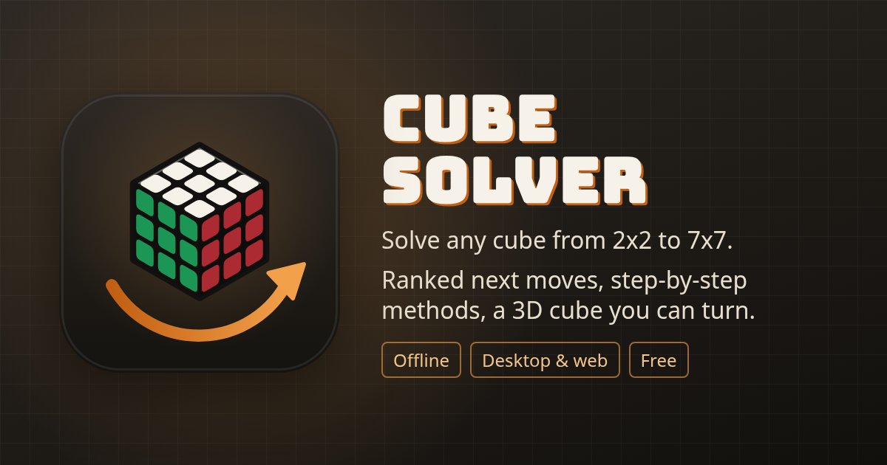</p>

<h1 align="center">Cube Solver</h1>

<p align="center">
  Set up any cube from 2x2 to 7x7, by scrambling, turning or painting stickers, and get<br />
  solutions (optimal on the 2x2 and 3x3), next moves ranked by distance, and step-by-step<br />
  breakdowns, all animated on a true-to-life 3D cube you can grab, turn, zoom into and take apart.
</p>

<p align="center">
  <a href="https://github.com/ccharafeddine/cube-solver/actions/workflows/ci.yml"></a>
  <a href="https://github.com/ccharafeddine/cube-solver/releases/latest"></a>
  <a href="LICENSE"></a>
</p>
<p align="center">
  
  
  
  
  
</p>

<p align="center">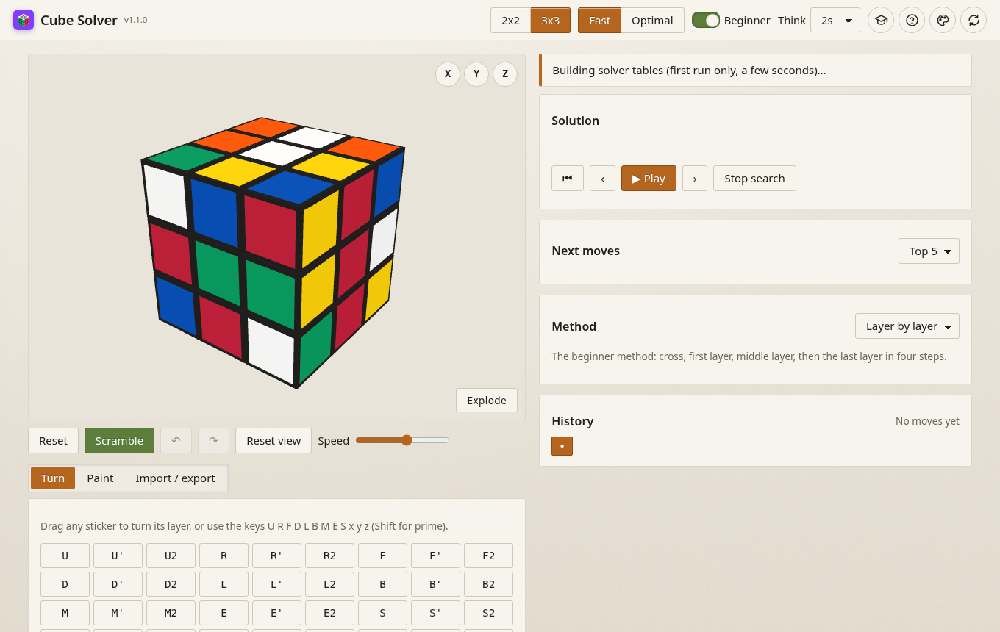</p>
<p align="center">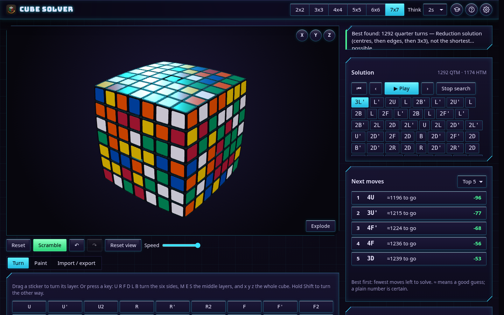</p>

<table align="center"><tr>
  <td width="40%">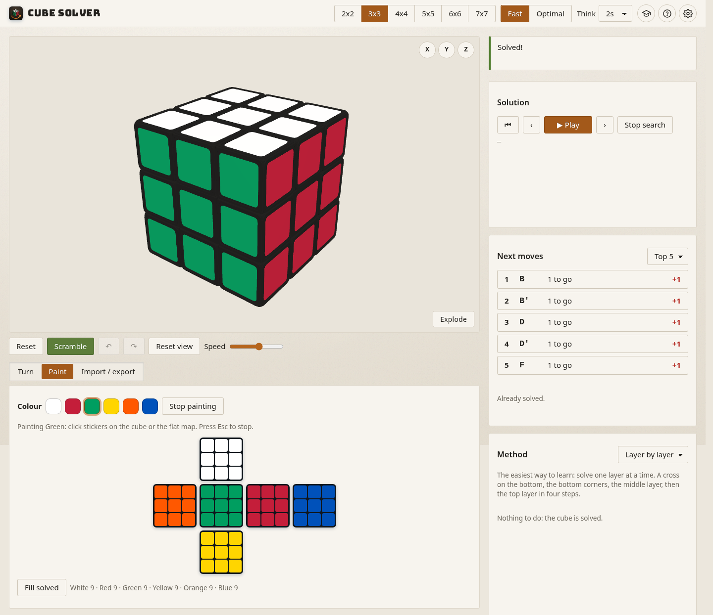<p align="center"><sub>Paint a real cube's colours on the 3D cube or the flat net</sub></p></td>
  <td width="33%">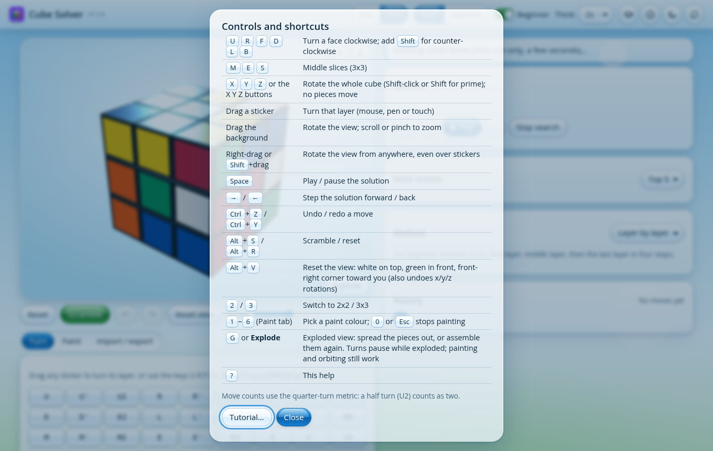<p align="center"><sub>Every shortcut, one keypress away (<kbd>?</kbd>)</sub></p></td>
  <td width="20%">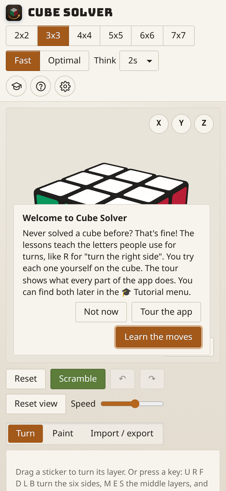<p align="center"><sub>Phones and touch</sub></p></td>
</tr></table>

<table align="center"><tr>
  <td width="45%">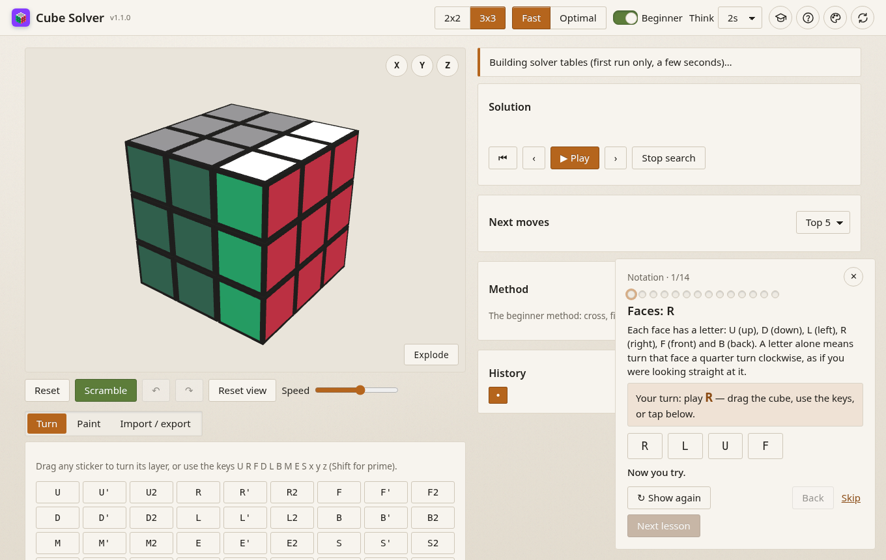<p align="center"><sub>Notation lessons: watch the move, then play it yourself</sub></p></td>
  <td width="33%">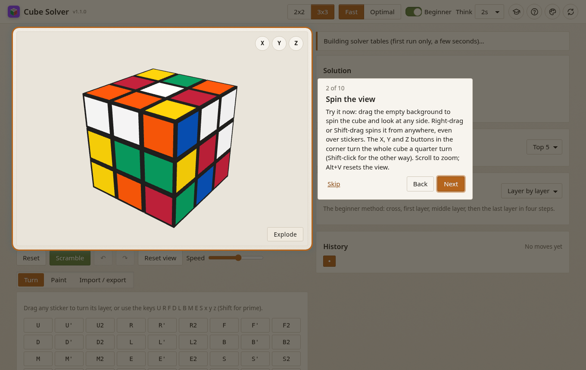<p align="center"><sub>A spotlight tour of every part of the app</sub></p></td>
  <td width="18%">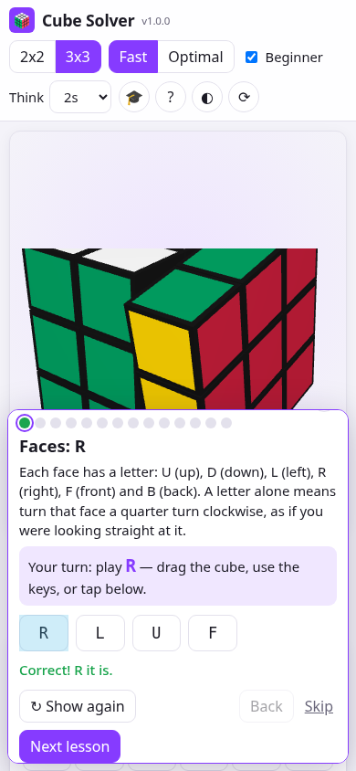<p align="center"><sub>Lessons on a phone</sub></p></td>
</tr></table>

## Contents

[Features](#features) · [Download](#download) · [Quick start](#quick-start) · [Tutorial](#tutorial) · [Controls](#controls-and-shortcuts) · [Solvers](#how-the-solvers-work) · [The 3D cube](#the-3d-cube) · [Theming](#theming) · [Builds](#building-and-packaging) · [Troubleshooting](#troubleshooting) · [Architecture](#architecture) · [Testing](#testing) · [Releasing](#releasing) · [Brand assets](#brand-assets) · [License](#license)

## Features

**Cubes**
- **Six sizes, 2x2 to 7x7**, switched with the size buttons or keys <kbd>2</kbd>–<kbd>7</kbd>. Every size starts solved.
- **True to life in 3D:** hollow plastic pieces with rounded edges, and stickers set slightly into each piece with a black ridge around them, in every theme. The 2x2 to 5x5 are flat; the 6x6 and 7x7 have **pillowed faces** like the V-Cube 6b and 7, a true spherical curve through each face's corners that bends the pieces themselves.
- **Exploded view** on every size shows the real mechanism inside (see [The 3D cube](#the-3d-cube)).
- **Zoom right into the cube:** scroll or pinch from 2.5x out to a few hundredths of a cubie from the centre, to look at the mechanism from inside.

**Turning and setup**
- **Drag a sticker** to turn its layer, with mouse, pen or touch, on any size and any layer, from any viewing angle. Drag the background (or right-drag / <kbd>Shift</kbd>-drag anywhere) to look around.
- **Keyboard:** U R F D L B turn the faces, M E S the 3x3 slices, x y z rotate the whole cube; <kbd>Shift</kbd> for counter-clockwise. **X Y Z** buttons on the cube view do the rotations too.
- A **move pad** and a box for typing algorithms (`R U R' U'`, `F2`, `M'`, `Rw`, `x`, and on big cubes SiGN layers such as `2R` or `3Rw`).
- **Paint** a real cube's colours on the 3D cube or on a flat **net** that scales to fit any size. The net is all buttons, so it works from the keyboard and with screen readers.
- **Solvability check:** impossible states are explained (wrong colour counts, impossible or twisted corners, flipped edges, parity).
- **Import / export:** facelet strings, JSON, the solution as text, a downloadable `.json`, and **share links** that carry the cube in the URL.

**Scrambles, history and playback**
- **Scramble** plays turn by turn, a little faster than normal playback (about 1.75x the speed slider, 60–260 ms a turn), and every turn goes into the history. Random-state on the 2x2 and 3x3; random single-layer turns on big cubes (40 on a 4x4 up to 100 on a 7x7).
- **Two-way timeline:** the **History** list shows every move, scrambles included. Click any move to walk there, forwards or backwards, one animated turn at a time; **Undo**/**Redo** step through it.
- **Solution timeline:** play/pause, step forward and back, back to start, or click any move to play up to it. Long solutions scroll in their own box that follows the current move, with the controls always in view.
- **Speed slider** sets the pace of every animation: turns, solutions, method steps and scrambles. The system's reduced-motion setting is respected.

**Solving**
- **2x2: always optimal** from a complete table of all 3,674,160 positions.
- **3x3 Fast:** Kociemba's two-phase algorithm, about 20 moves in milliseconds, improving while it thinks.
- **3x3 Optimal:** IDA* with pattern databases for the proven-shortest solution, with live progress and a Stop button.
- **4x4 to 7x7: reduction**, the way people solve them by hand: parity, centres, edges, then the 3x3 stage.
- **Next moves ranked by distance:** every possible turn with how far it leaves you from solved and the change it makes (−1 is progress). Proven distances are shown plainly; estimates are marked ≈ (always on big cubes).
- **Methods:** Layer by layer, CFOP, Roux and ZZ on the 3x3; the reduction steps on big cubes. Each step is named and counted; play one step or all of them.
- Counts use the **quarter-turn metric** (U2 counts as two), with the half-turn count alongside.

**App**
- Runs in the **browser**, installs as an offline **PWA**, and installs on **Windows** as a desktop app of about 2 MB (Tauri 2).
- **Four themes** (Matte, Frutiger Aero, Neon, Neubrutalism), each light and dark, in **Settings** (⚙) with the update check and About.
- An interactive **tutorial** and app **tour**, a shortcut sheet, an error banner with Reload, and a solver that restarts itself if it crashes.
- A wide-screen layout whose buttons stay put: fixed panel heights and a reserved scrollbar gutter, so nothing shifts as solutions and analysis change. It folds to one column on phones and tablets. Every control has an accessible name and visible focus.
- Solver work never runs on the UI thread: it happens in a Web Worker, and solver tables are cached in IndexedDB.

## Download

Prebuilt binaries are on the [releases page](https://github.com/ccharafeddine/cube-solver/releases/latest):

- **Windows installer:** `Cube Solver_<version>_x64-setup.exe`, a per-user install (no admin rights). It adds Start Menu and desktop shortcuts and an uninstall entry under Settings → Apps.
- **Windows MSI:** `Cube Solver_<version>_x64_en-US.msi`, for managed installs.
- **Web bundle:** `cube-solver-web-<version>.zip`, a static site you can host anywhere.

The binaries are unsigned, so SmartScreen may warn on first run: choose **More info → Run anyway**. The desktop app needs WebView2, which ships with Windows 10 and 11.

## Quick start

Requirements: Node.js 20+ and npm.

```bash
npm install
npm run dev        # http://localhost:5173
```

## Tutorial

The first time you open Cube Solver, a welcome card offers **Learn the notation**, **Tour the app** or **Not now**. Whatever you pick, the 🎓 button in the header (also reachable from the help dialog) opens the Tutorial menu at any time. The menu shows your progress, for example `5/14 lessons · quiz best 6/6 · tour done`, and offers to resume, start over, take only the quiz, or reset progress. The offer is not shown when the app is opened from a share link.

**Notation lessons.** The lessons take over the 3D view with a solved 3x3 and give your own cube back when you close them.

| # | Lesson | You play |
|---|---|---|
| 1–4 | Faces: R, U, F, then D L B | `R`, `U`, `F`, `D L B` |
| 5 | Prime | `R'` |
| 6 | Double turns | `U2` |
| 7–9 | Slices M, E, S | `M`, `E`, `S` |
| 10 | Wide moves | `Rw` |
| 11–13 | Rotations x, y, z | `x`, `y`, `z` |
| 14 | Counting quarter turns | `R U2 R'` (4 QTM) |

Each lesson:
1. Dims the cube except the layer that will turn.
2. Animates the move, then undoes it.
3. Asks you to play it. You can drag the cube, use the keyboard, type it in the Turn tab, or tap one of the answer buttons. The buttons make it work on phones and with screen readers.
4. Checks the cube's state, not your keystrokes. So `U U` counts as `U2`, and `R M'` counts as `Rw`. Part of a longer answer gets "keep going" and the next layer is spotlit. A wrong move gets an explanation and a hint, and the cube resets so you can try again.

The dots across the top jump to any lesson, and **Show again** repeats the demonstration. The quiz checks what you learned: what a prime does, counting quarter turns, which face M follows, rotations, wide moves, and inverses. Each answer comes with an explanation.

**App tour.** A spotlight box, the target's outline plus 8px, sits over one part of the app at a time, and everything else is heavily dimmed. The box and the step card glide between steps in about 0.3 s, or jump instantly when the system asks for reduced motion. The 11 steps:

1. Your cube
2. Picking a size (and what big cubes do differently)
3. Spinning the view, including the X, Y and Z buttons
4. Drag-to-turn
5. Painting and the net editor
6. Scramble, reset and undo
7. Solving, with the Fast/Optimal switch
8. Ranked next moves
9. Method breakdowns
10. History
11. Share and export

- **Try it in place.** Clicks inside the spotlight reach the real control. A step can ask you to spin the view, drag a sticker or press Scramble, and the tour stays open. The dimmed area is four click-catching rectangles around the hole, not a full-screen blocker.
- **Navigation.** An "N of 11" counter, plus **Skip**, **Back** and **Next** (**Done** on the last step). The ← → keys move between steps. **Esc** or clicking the dimmed area closes the tour. Nothing advances on its own.
- **Placement.** The card parks beside large targets such as the 3D cube, and below or above small ones, always on screen. On phones it docks to the bottom. Each target is scrolled into view first, and everything repositions on resize and scroll.
- **Adapting.** Steps whose target isn't visible, such as the 3x3-only method card on a 2x2, are dropped. On touch screens the steps say "tap" and "swipe" instead of "click" and "drag".
- **Accessibility.** The card is a modal dialog with a focus trap. Tab stays inside it, and closing returns focus to where you were.
- **Starting it.** The welcome card offers it on first launch, and the 🎓 Tutorial menu resumes it or replays it from the start.

**Saved progress** lives in `localStorage` (`cube-solver-tutorial`): finished lessons, where to resume the lessons and the tour, and your best quiz score. Corrupt or outdated data falls back to a fresh start.

## Controls and shortcuts

| Control | What it does |
|---|---|
| Drag a sticker | Turn that layer in the drag direction: any layer, any size, any viewing angle |
| Drag the background | Rotate the view |
| Right-drag, or <kbd>Shift</kbd>+drag | Rotate the view from anywhere, even starting on a sticker (it never turns a layer) |
| Scroll / pinch | Zoom, from 2.5x out to right inside the cube to see the mechanism |
| **Reset** (<kbd>Alt</kbd>+<kbd>R</kbd>) | Back to solved |
| **Scramble** (<kbd>Alt</kbd>+<kbd>S</kbd>) | Random-state scramble, played turn by turn from solved (about 1.75x the slider speed, 60-260 ms a turn) and recorded in the history; its moves appear in the move box. Undo or any new action stops it where it is |
| ↶ / ↷ (<kbd>Ctrl</kbd>+<kbd>Z</kbd> / <kbd>Ctrl</kbd>+<kbd>Y</kbd> or <kbd>Ctrl</kbd>+<kbd>Shift</kbd>+<kbd>Z</kbd>) | Undo / redo a move |
| **Reset view** (<kbd>Alt</kbd>+<kbd>V</kbd>) | The standard view: white on top, green in front (so red is R and orange is L), seen from slightly above with the front-right corner toward you. The camera is re-centred on the cube and its distance is fitted to the window (field of view and aspect), so the whole cube shows with a margin on any screen. The first load uses the same framing. Also undoes any x/y/z rotations, played as rotation moves so history stays consistent |
| **Speed** slider | Pace of every animation: turns, solution and method playback, scrambles |
| <kbd>U</kbd> <kbd>R</kbd> <kbd>F</kbd> <kbd>D</kbd> <kbd>L</kbd> <kbd>B</kbd> | Turn a face clockwise; with <kbd>Shift</kbd>, counter-clockwise |
| <kbd>M</kbd> <kbd>E</kbd> <kbd>S</kbd> | Middle slices (3x3 only) |
| <kbd>X</kbd> <kbd>Y</kbd> <kbd>Z</kbd>, or the **X Y Z** buttons on the cube | Rotate the whole cube a quarter turn (x like R, y like U, z like F); <kbd>Shift</kbd>+key or <kbd>Shift</kbd>+click for the prime. Rotations move no pieces |
| <kbd>G</kbd>, or **Explode** / **Assemble** | Exploded view with the mechanism, on every size. Turns pause while exploded; orbiting and painting work |
| <kbd>2</kbd>–<kbd>7</kbd>, or the size buttons | Switch cube size, 2x2 to 7x7 (starts solved) |
| **Fast / Optimal** | 3x3 solver mode (the 2x2 is always optimal; big cubes use reduction) |
| **Think** | Time limit for the search (1–60 s) |
| <kbd>Space</kbd> / **▶ Play** | Play or pause the solution |
| <kbd>→</kbd> / <kbd>←</kbd>, **›** / **‹** | Step the solution forward / back |
| **⏮** | Back to the start of the solution |
| Click a solution move | Play up to that move |
| Click a candidate | Play that move |
| **Stop search** | Stop thinking and keep the best solution so far |
| **Method** menu | Layer by layer, CFOP, Roux or ZZ on the 3x3; reduction steps on big cubes. **Play step** / **Play all steps** |
| **History** | Click any move to walk there, forwards or backwards, one animated turn at a time; • is the start, the highlighted move is where you are. ← steps back through the history when no solution is being followed |
| **Paint** tab | Colour swatches (<kbd>1</kbd>–<kbd>6</kbd>), then click stickers on the cube or the net; <kbd>0</kbd> or <kbd>Esc</kbd> stops painting. With no colour picked, clicking a net sticker cycles its colour |
| **Fill solved** | Reset the net to a solved cube |
| **Import / export** tab | Import a facelet string, JSON or moves; copy facelets, JSON, the solution or a share link; download `.json` |
| **?** | Shortcut sheet, with a link to the Tutorial menu |
| **🎓** | Tutorial menu: notation lessons, quiz and app tour (resume or replay) |
| **⚙** | Settings: theme and light/dark/system, Check for updates, and About (the version). <kbd>Esc</kbd> closes it |

**Facelet string format:** 6·N² letters (24 for the 2x2, 54 for the 3x3, 294 for the 7x7), one per sticker, faces in the order U, R, F, D, L, B, each read row by row as on the unfolded net, using the face letters as colours. A solved 3x3 is `UUUUUUUUURRRRRRRRRFFFFFFFFFDDDDDDDDDLLLLLLLLLBBBBBBBBB`. Share links use the same string: `#n=<size>&f=<facelets>`.

## How the solvers work

| Solver | Algorithm | Notes |
|---|---|---|
| 2x2 optimal | BFS over all 7!·3⁶ = 3,674,160 states (DBL corner fixed) with U/R/F quarter turns | One byte per state; solutions walk downhill through the table. God's number is 14 in the quarter-turn metric, and a test checks it |
| 3x3 Fast | Kociemba two-phase. Phase 1 reaches ⟨U, D, R2, L2, F2, B2⟩ (twist, flip, slice); phase 2 solves within it (corner perm, edge perm, slice perm) | Both phases use IDA* with pruning tables over coordinate pairs. Move tables are built by BFS from solved. It keeps lengthening phase 1 to find shorter totals and streams each improvement |
| 3x3 Optimal | IDA* over quarter turns; heuristic = max of five pattern databases (corners URF/UFL/ULB/UBR, corners DFR/DLF/DBL/DRB, edges 0–4, 5–9, 7–11) | Each database gives the exact distance for its piece group, so the maximum is admissible and the first solution found is optimal. The tables (~25 MB) take ~3 s to build once, then load from IndexedDB |
| Ranking | Exact distances from the 2x2 table or the optimal search when that's quick; otherwise an upper bound from a 50 ms two-phase run, clamped by certainties (at most current+1; the solution's own first turn is current−1) | Ties are broken by the pattern-database lower bound. When the upper and lower bounds meet, the distance is proven and shown without ≈ |
| Methods | Per step, IDA* over the moves that method uses (guided by exact per-piece distance tables), or iterative deepening over whole algorithms plus U turns for last-layer steps | Roux's last six edges search M/U on stickers, because M moves centres |

The cube is modelled twice. The sticker model derives every move from 3D geometry, so it works for any size and the renderer uses the same coordinates. The cubie model uses Kociemba's conventions for the solvers. Tests apply every move in both models and check they agree.


### Big cubes (4x4 to 7x7)

Big cubes are solved by **reduction**, the way people solve them by hand (`src/solver/big/`):

1. **Fix parity.** Even cubes can have two problems a 3x3 never has. OLL parity is an odd swap of edge pieces (wings); one quarter turn of an inner layer fixes it. PLL parity is an odd corner permutation; one outer turn fixes it. Both are spotted from the start position and fixed first.
2. **Solve the centres** with pure 3-cycles (commutators that move exactly three centre stickers and nothing else).
3. **Pair the edges** with pure 3-cycles of wing pieces.
4. **Solve it like a 3x3** with the two-phase solver, using outer turns only, which keep the centres and edges intact.

The 3-cycles are not hand-written: a short search finds every commutator of the form `[a b a', c]` (single-layer turns) that moves exactly three pieces of one orbit, and conjugating them by setup turns covers every triple of positions, fewest setup turns first. The same code serves every size; the library is built once per size (about 0.2 s for a 4x4, 2 s for a 7x7). Typical solutions: about 320 quarter turns on a 4x4, 450 on a 5x5, 900 on a 6x6 and 1200 on a 7x7. Every solution is checked by playing it back before it is shown.

Inner layers use SiGN notation: `2R` turns only the second layer from the right, `3Rw` the three right layers together.

**Next moves on big cubes** rank every single-layer quarter turn by the length of the reduction solution from the resulting position. That measures progress through the reduction, not a proven distance, so every number is marked ≈.

On odd cubes the edges are paired to their middle piece (midge), so parity there is just the one inner-slice turn; even cubes take their colour scheme from a corner.

## The 3D cube

The cube is drawn with three.js. Each piece is a hollow shell, open toward the core, with rounded edges and a raised black ridge around a slightly recessed rounded sticker. Pieces of the same shape share one geometry, so even the 7x7 (about 1,050 meshes) orbits smoothly.

**Pillowing.** The 6x6 and 7x7 faces are each a spherical cap through the face's four corners (bulging 0.42 and 0.48 cubie units at the middle). The pieces bend with it, not just the stickers, so the plastic and stickers stay flush. The 2x2 to 5x5 stay flat, like the common real puzzles.

**Exploded view** (**Explode**, or <kbd>G</kbd>). Every piece glides outward along the line from the centre to its home slot, with dashed guide lines back to each slot, ghost outlines of the empty slots and a grid below. **Assemble** reverses smoothly from wherever the animation is. While exploded, orbiting and painting still work, and turns and playback pause with a hint, so the picture never gets out of step with the cube. Every mechanism part is drawn from both sides, so nothing vanishes when you zoom in among them. The mechanism in each size follows the real design:

| Size | Mechanism shown | Based on |
|---|---|---|
| 2x2 | Six thin axle spindles meeting at the centre, springs and screws under hidden centre caps, and a foot on each corner clipping under the caps | The common 2x2 design with a hidden 3x3-style core |
| 3x3 | A fixed core with six arms; hollow centres with a tube the arm enters, the screw and spring inside; edge feet in the track under the centres, corner feet under the edges | The standard 3x3 mechanism |
| 4x4 | A ball core carrying eight raised spherical triangles that leave three perpendicular grooves; only the centres reach the ball, on cams in the grooves; edges hook onto centres and corners onto edges | Sebestény's Rubik's Revenge, [US 4,421,311](https://patents.google.com/patent/US4421311A); Wikipedia "Rubik's Revenge"; twistypuzzles.com puzzle database |
| 5x5–7x7 | A solid 3D cross; every piece is a cubic part on a conical stalk ending in a foot that is a piece of a spherical shell; the corners reach nearly to the centre; odd cubes screw their fixed centres to the cross, and the 6x6's cross ends in six hidden fixed centres | Verdes' V-Cube, EP1599261 / US 2007/0057455; Wikipedia "V-Cube 6", "V-Cube 7" and "Professor's Cube"; v-cubes.com and its 2026 catalogue |

The 5x5 stays flat because the common real 5x5 is flat (V-Cube offers pillowed versions of every size "except the V-5"). The research notes are in [PLAN.md §10](PLAN.md).

## Theming

The look is built in two layers:

| Layer | File | What it holds |
|---|---|---|
| Tokens | `src/theme/tokens.css` | Every surface, gradient, gloss, radius, shadow, blur, accent, text colour and texture, as CSS custom properties per skin (`:root[data-skin=…]`) with a dark variant |
| Components | `src/style.css` | Panels, buttons, tabs, toggles, dialogs, tour and coach cards. These read tokens only (a test fails if they use an undeclared one) |
| Scene | `src/theme/skins.ts` | The 3D side of each skin: plastic colour and roughness, sticker clear-coat gloss, and ambient, key, sky and rim lights for light and dark |

There are four themes. Pick one in **Settings** (⚙ at the top right, or **Settings…** in the help menu), along with Light, Dark or System. Settings also holds **Check for updates** and **About** (the version). It is a modal dialog: keyboard and touch friendly, <kbd>Esc</kbd> or a click outside closes it, and the chosen options are marked with a fill and a ✓. The choice applies instantly and is saved (`cube-solver-skin` and `cube-solver-theme` in `localStorage`).

| Theme | Modes | Look |
|---|---|---|
| **Matte** (default) | Light, dark | Calm paper-grain background, flat solid panels, soft light, matte stickers |
| **Frutiger Aero** | Light, dark | Glossy sky glass, bubbles and gel buttons |
| **Neon** | Light, dark | Dark: deep surfaces, glowing cyan edges and a faint grid that pair with the exploded view's glow lines. Light: bright clean surfaces with the same glowing cyan/violet edges and grid |
| **Neubrutalism** | Light, dark | Flat bold colours and thick outlines with hard offset shadows: black on cream in light, light outlines with shadows in cube colours on charcoal in dark |

The title uses the bundled Bungee font, styled per theme. Each theme also has its own corners, set by tokens per size tier (panel, card, control, chip): Matte uses 2-4px radii with a hairline double-line edge; Aero rounds only the top corners with a gloss band; Neon chamfers panel corners with a glowing line along each cut; Neubrutalism stays nearly square and lets the heavy outline and offset shadow do the work. Focus rings follow each shape. Every theme has light and dark, each with its own 3D lighting and plastic. Light, Dark or System applies to all of them; System follows the OS setting live, without a reload. `?skin=neon` (or `matte`, `aero`, `brutal`) previews a theme without saving it. Every theme defines every token, which a test checks. Under reduced transparency, panels become solid and blur is turned off; reduced motion also removes the Neubrutalism press nudge. Contrast is checked in tests to meet WCAG AA for body text, muted text and text on buttons in every theme. Selects and their native option lists take solid colours from the theme so they stay readable on Windows.

<p align="center">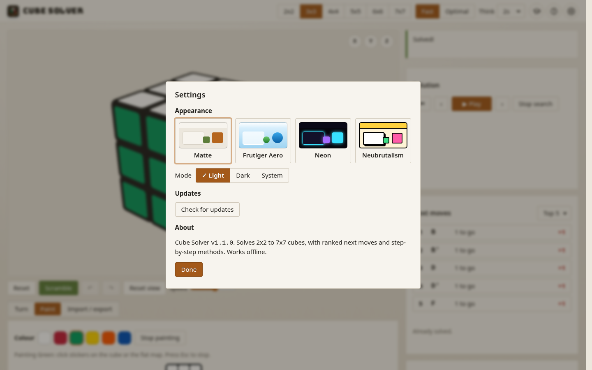</p>
<p align="center">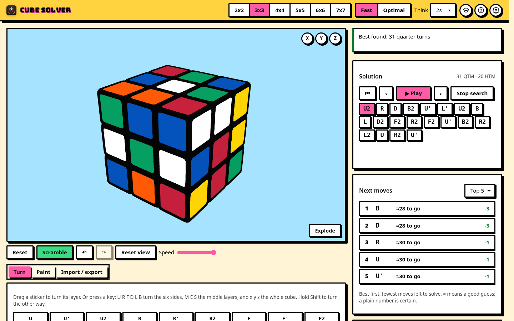</p>

## Building and packaging

### Web

```bash
npm run build      # type-check + production build to dist/
npm run preview    # serve dist/ at http://localhost:4173
```

`dist/` uses relative paths, so it works from any static host or sub-folder.

### PWA (installable, offline)

Serve `dist/` over https, or from localhost with `npm run preview`. Open it in Chrome or Edge and use the install icon in the address bar; on phones, use **Add to Home Screen**. The service worker (`public/sw.js`) fetches pages network-first, so new releases show up on the next online launch, and serves assets cache-first, so the app works offline. Bump `CACHE` in `sw.js` if you change its caching rules.

### Desktop (Windows, Tauri 2)

Prerequisites:
- [Rust](https://rustup.rs) (stable) and the **Microsoft C++ Build Tools** ("Desktop development with C++")
- WebView2 (already on Windows 10/11)
- **At least 10 GB free on the drive with the repo** (see Troubleshooting)

```bash
npm run desktop:dev   # desktop window against the dev server, with hot reload
npm run desktop       # release build and installers
```

The output goes to `src-tauri/target/release/`:
- `bundle/nsis/Cube Solver_<version>_x64-setup.exe`: per-user installer
- `bundle/msi/Cube Solver_<version>_x64_en-US.msi`
- `cube-solver.exe`: the bare app, if you don't want an installer

The first release build compiles about 400 crates and takes several minutes; later builds take seconds to a minute.

## Troubleshooting

- **`LLVM ERROR: IO failure on output stream: no space on device`** (or similar) during `npm run desktop`: the disk is full. The Rust build directory grows to several GB. Free at least 10 GB, delete `src-tauri\target` if a half-finished build is taking space, and rebuild. To see free space in PowerShell: `Get-PSDrive C`.
- **SmartScreen blocks the installer:** the binaries are unsigned. Choose **More info → Run anyway**.
- **`link.exe not found` / MSVC errors:** install the Microsoft C++ Build Tools with the "Desktop development with C++" workload, then open a new terminal.
- **Port 5173 already in use:** the dev server uses a fixed port (Tauri's dev mode expects it). Stop the other process or change `server.port` in `vite.config.ts` and `devUrl` in `src-tauri/tauri.conf.json` together.
- **"Building solver tables…" every time:** the browser is blocking IndexedDB (private mode, or storage disabled). Everything still works; startup is just about 3 s slower.
- **Optimal mode never finishes on a scrambled cube:** expected for deep positions. The status shows the depth already proven; raise **Think**, or use Fast mode (usually within a few moves of optimal).
- **The PWA shows an old version:** reload once while online. The page is fetched network-first and the new assets are cached.
- **Update check says it could not reach GitHub:** you are offline, or GitHub's API rate limit was hit. It is only a check; nothing breaks.

## Architecture

```
src/
  cube/
    facelets.ts     NxN sticker model; moves from 3D geometry; M/E/S, wide moves, rotations; turn<->notation
    cubie.ts        Kociemba cubie model, facelet<->cubie, solvability checks
    orient.ts       standard orientation (white U, green F) for any size; the rotation that restores it
    notation.ts     parse/format, inverse, simplify, QTM/HTM counts
  solver/
    solver2.ts      2x2 optimal (full BFS table)
    coords.ts       Kociemba coordinates; generic move/pruning table builders
    twophase.ts     3x3 Fast (two-phase, streaming)
    pdb.ts          pattern databases (corner and edge groups), lower bound
    optimal3.ts     3x3 Optimal (IDA* + PDBs, progress, cancel)
    rank.ts         candidate ranking by distance
    big/            reduction for 4x4-7x7: core.ts (pieces, orbits), reduce.ts (3-cycle search, parity, phases), analyze.ts
    methods/        common.ts (piece and macro searches), lbl.ts, cfop.ts, roux.ts, zz.ts, index.ts
    analyze.ts      one full analysis: validity, solution, candidates, method (pure, tested)
    worker.ts       Web Worker: loads/builds tables (tableCache.ts, IndexedDB), runs analyze
    protocol.ts     worker message types
  app/
    history.ts      move history with cursor (undo/redo/jump)
    share.ts        facelet string, JSON, URL hash, import parsing
    drag.ts         drag vector -> layer turn (any size, in-face motion)
    pace.ts         paced playback and scramble timing
    update.ts       GitHub release check
  ui/
    scene.ts        three.js view: meshes, mechanisms, turn animation queue, pointer input
    pieces.ts       hollow piece shells, ridges, inset stickers, spherical pillowing (pure, tested)
    scroll.ts       keep the current move in view inside its list
    explode.ts      exploded-view maths: easing, offsets, stagger, controller (pure, tested)
    framing.ts      camera framing and zoom limits for any FOV/aspect (pure, tested)
    net.ts          flat net editor
  theme/
    tokens.css      design tokens per skin: matte, aero, neon, brutal, each light and dark
    skins.ts        scene parameters per skin, skin and theme selection (tested with the tokens)
  tutorial/
    lessons.ts      lesson, quiz and tour content; attempt checking; saved progress (pure, tested)
    tutorial.ts     coach panel, demonstrations, quiz; starts the tour
    spotlight.ts    spotlight tour: hole/dim/card geometry (pure, tested), focus trap, keys
  assets/fonts/     the bundled title font (Bungee, OFL)
  main.ts           UI wiring, keyboard, Settings and other dialogs, error banner
public/             manifest, service worker, icons, social card
brand/              logo and social card sources
src-tauri/          Tauri 2 shell (Rust), config, capabilities, icons
```

**Data flow:** every change produces a new sticker state. `main.ts` posts it to the worker with the current settings, and the worker streams back `status`, `progress` and `result` messages, each tagged with a request id so stale answers are dropped. A busy worker can't be interrupted, so a new request replaces it. The IndexedDB table cache keeps that cheap.

**Why the stack:** one TypeScript codebase serves the browser, the PWA and the desktop app. Tauri uses the system WebView2, so the installer is about 2 MB instead of Electron's 100 MB or so, and the solver runs in the same worker everywhere.

## Testing

```bash
npm run lint        # ESLint (typescript-eslint)
npm test            # Vitest
npm run typecheck   # strict TypeScript
npm run build       # type-check + production build
```

The tests cover:
- Move identities on every size from 2x2 to 7x7, and agreement between the sticker and cubie models for all 18 moves.
- Notation round-trips, and every solvability rule.
- The 2x2 table: every state reached, maximum distance 14. 200 random 2x2 solves are optimal.
- Two-phase on random scrambles and the superflip.
- The optimal 3x3, the pattern-database bound never exceeding a proven optimum, and progress and cancel.
- Every method breakdown on random cubes.
- Ranking order and tie-breaking, and the full worker analysis.
- Big-cube reduction on every size from 4x4 to 7x7: parity, 3-cycle coverage, and full solves played back.
- History, import/export, share URLs, paced playback, update-check version logic.
- Drag-to-turn on every size: the expected move for drags on each face, and from five viewing angles that every drag turns the grabbed layer the way it goes.
- Piece shells, inset stickers and pillowing (only the 6x6 and 7x7, a true sphere through the corners), camera framing and zoom limits.
- Themes: every skin defines every token, AA contrast in all eight variants, the bundled font, the Settings dialog contents and that every icon exists.
- The spotlight geometry: 8px padding, the four dim rectangles tiling the screen around the hole, the card beside large targets and below or above small ones, always on screen. Also visible-step filtering, the counter text, and touch wording.
- The tutorial: every direction the lessons describe is checked against the cube model, along with attempt checking (equivalent sequences, partial progress, wrong moves), quiz answers and grading, that every tour target exists in the page, and loading saved progress, including corrupt data.

Every solver's output is played back to confirm the cube ends up solved. CI runs lint, tests and build on every push and pull request.

## Releasing

1. Bump `version` in `package.json`, `src-tauri/tauri.conf.json` and `src-tauri/Cargo.toml`.
2. Write `docs/release-notes/v<version>.md`.
3. Commit, then `git tag v<version>` and `git push origin master --tags`.

The [release workflow](.github/workflows/release.yml) creates the GitHub release from the notes file, builds the Windows installers on a Windows runner and the web bundle on Linux, and attaches them all. The app's update check then offers the new version to existing users.

To release by hand from Windows: `npm run desktop`, then `gh release create v<version> --notes-file docs/release-notes/v<version>.md "src-tauri/target/release/bundle/nsis/*.exe" "src-tauri/target/release/bundle/msi/*.msi"`.

## Brand assets

The logo is original artwork: an isometric cube with inset, rounded stickers on black plastic (like the 3D cube) and a solve arrow. The SVG sources live in `brand/`:

- `brand/icon.svg`: the app icon and header mark (copied to `public/icon.svg`, the favicon).
- `brand/icon-maskable.svg`: full-bleed version with the mark inside the maskable safe zone.
- `brand/og-image.html`: the social/OG card, rendered to `public/og-image.png` (1200x630).

PNG sizes (`public/icon-192.png`, `icon-512.png`, `icon-1024.png`, `icon-maskable-512.png`) are rendered from the SVGs. The desktop icons in `src-tauri/icons/` (PNG, `.ico`, `.icns`) come from `npx tauri icon public/icon-1024.png`. README screenshots in `docs/` are taken from the running app.

The title font is [Bungee](https://github.com/djrrb/Bungee) (SIL Open Font License, `src/assets/fonts/Bungee-OFL.txt`), bundled with the app, so it works offline and in the desktop app.

## Roadmap

See [PLAN.md](PLAN.md) and [progress.txt](progress.txt). Ideas: shorter big-cube solutions (combined 3-cycles, wide-move edge pairing), stronger optimal-search tables, full OLL/PLL sets, and camera scanning of a real cube.

## License

[MIT](LICENSE) © ccharafeddine. All solver code is original; no GPL code is used. Runtime dependencies: [three.js](https://threejs.org) (MIT) and, in the desktop app, [Tauri](https://tauri.app) (MIT/Apache-2.0). The title font, Bungee, is under the SIL Open Font License.
